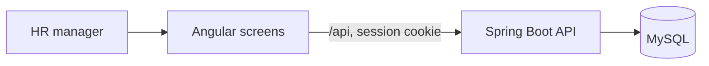

# Approach

This note records the decisions behind the salary app: how the pieces fit, what was left out on purpose, and how the 10,000-employee size was handled. Screens of the running app are in [snapshots](snapshots).

## Architecture

The HR manager uses an Angular app. That app talks only to a Spring Boot API. The API is the only program that reads and writes MySQL.

- **Screens** (`frontend`): sign-in, directory, add or edit employee, pay summary. The dev server proxies `/api` to port 8080.
- **API** (`backend`): sign-in, directory, employee writes, and the pay summary. Currency is copied from the employee’s country on the server.
- **Database** (`db/schema.sql`): countries, departments, employees, and one current salary per employee. `employee_compensation` is a saved join for inspection in MySQL Workbench. The API loads the same facts through JPA, with an entity graph so a page of employees does not become a query per row.
- **Sign-in**: one in-memory HR account. A session cookie is issued at login. The browser also sends the CSRF cookie on changes. Salary URLs answer 401 until that session exists.
- **Tests**: payroll math, employee rules, the summary, the directory query, the seed, and sign-in. Tests use an in-memory H2 database so they do not need the Workbench password.

## Trade-offs

- **MySQL.** The brief allows any relational database. MySQL was chosen because the data can be opened in MySQL Workbench. The schema is written by hand. The API does not create or alter tables.
- **One current salary.** Pay sits in its own table with a unique employee id. Version one stores the current amount only. A later history feature can drop that unique rule and add older rows without reshaping the employee.
- **Currency stays local.** Each country has one currency, and the salary row stores that code. Totals are grouped by currency. A single number that adds rupees to dollars would answer the wrong question.
- **Terminated people stay in the directory and drop out of pay totals.** The HR manager can still find them. Headcount, total, and average on the summary count people who are active or on leave.
- **One HR account, session cookie.** Employees do not sign in. A session matches the single-user product and works with Angular’s CSRF cookie. A token service would add machinery this version does not need.
- **Schema view versus API queries.** The view is a readable join for a person looking at the database. The API uses explicit queries so paging, filters, and the three summary groupings stay in the application code that is tested.
- **Salary range.** The requirements list a salary-range filter, and the salary table is indexed by currency and amount. That filter is not on the screen yet. Country, department, status, and name or code search are.

## Performance

Ten thousand employees is small for MySQL and too large to send to the browser at once.

- The directory is paged. Page size defaults to 20 and is capped at 100.
- Country, department, status, and last name plus first name are indexed for the filters.
- Name and code search uses a contains match. That is the right match for an HR lookup, and it does not use the name index for a leading wildcard. At this size the cap of 100 rows keeps the response small.
- The pay summary runs three grouped queries in the database. The browser receives a handful of currency, country, and department rows, not 10,000 salaries.
- The seed inserts 200 employees at a time, flushes, and clears the persistence context so the insert does not hold every new row in memory. It stops once the table already has 10,000 people. The generator uses a fixed random seed so a fresh database gets the same workforce.

## Instructions given to the AI

The build was directed in small steps, and each step was committed before the next one started.

- Explain the assessment in plain language, then build it. Write the one-page requirements before the code.
- Use MySQL and MySQL Workbench. Keep the database password out of git.
- Create a private GitHub repository and push incremental commits that show the order of the work.
- Load countries and departments first. Explain the salary view as a saved join, not a second copy of the data.
- Seed 10,000 employees without deleting people already in the table.
- Add the Angular directory, employee form, and pay summary, and check them in the browser.
- Add HR sign-in so salary data cannot be read before that sign-in succeeds.
- Add screen snapshots, then this note, so the thinking is in the repository with the code.
